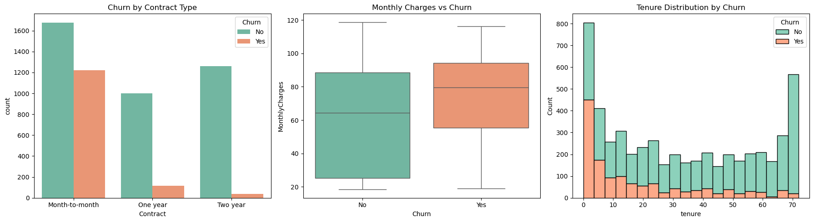

# Vodafone Customer Churn Prediction


A reproducible churn-prediction project: data audit, EDA, leakage-safe preprocessing, three competing models (Logistic Regression, Random Forest, XGBoost), evaluation focused on retention use cases, and a CLI to score new customers.

> Not affiliated with, or endorsed by, Vodafone. See [About the data](#about-the-data).

## Quickstart

```bash
git clone https://github.com/<your-username>/vodafone-customer-churn-prediction.git
cd vodafone-customer-churn-prediction
python -m venv .venv && source .venv/bin/activate      # Windows: .venv\Scripts\activate
pip install -e ".[dev]"                                 # add ,xgboost for the XGBoost model
```

**Try it with no download** (synthetic data, results are meaningless, output goes to `reports/demo/`):

```bash
python -m churn.train --demo --no-xgboost
```

**Run on the real data** (see [`data/README.md`](data/README.md) to download it):

```bash
python -m churn.train --data data/raw/customer_churn_data.xlsx --update-readme
```

This trains and compares the models, writes figures to `reports/figures/`, metrics to `reports/metrics.{json,md}`, saves the best pipeline to `models/best_model.joblib`, and fills in the results table below.

**Score new customers:**

```bash
python -m churn.predict --model models/best_model.joblib --data new_customers.xlsx --out churn_scores.csv
```

**Explore interactively:** open `notebooks/01_churn_eda_and_modeling.ipynb` (`pip install -e ".[notebook]"`).

## About the data

- Source: the Kaggle dataset "Vodafone Customer Churn" (MIT licence listed on the page). 7,043 rows x 23 columns, target `Churn` (Yes/No). The file is **not** included in this repo.
- Contents: customer demographics, services subscribed, contract and billing, `tenure`, `MonthlyCharges`, `TotalCharges`, support-ticket counts and a `Location` field. Full column list in [`data/README.md`](data/README.md).
- Missing values: `numAdminTickets` (592), `StreamingMovies` (506), `StreamingTV` (427), `gender` (396) and `TotalCharges` (11).
- **Provenance caveat.** The first rows (customer IDs, tenure, charges) look the same as the widely circulated IBM Telco Customer Churn sample, plus extra columns. I could not verify where the data came from, so treat it as a public teaching dataset and do not read the results as statements about Vodafone's real customers.

## Approach

1. **Clean**: trim text, turn `None`/blank cells into `NaN`, coerce `TotalCharges` to numeric. No rows are dropped for missing features.
2. **Engineer**: `TotalTickets` (admin + tech), `Region` and `State` split from `Location`; drop `customerID`.
3. **Preprocess inside the pipeline**: median imputation with missing-value flags and scaling for numerics; `Unknown` fill and one-hot encoding for categoricals. Fitted on training folds only.
4. **Model**: Logistic Regression, Random Forest, and XGBoost (if installed), all class-weighted for the churn imbalance.
5. **Select and evaluate**: stratified 80/20 split; models ranked by 5-fold cross-validated ROC-AUC on the training split; the test set is used once for reporting ROC-AUC, PR-AUC, precision, recall, F1 and top-decile lift.

### What changed from the original notebook

| Original notebook | This project |
|---|---|
| `dropna()` after filling only `TotalCharges` removed every row with a missing `gender`, streaming or ticket field: between 592 and 1,932 of the 7,043 rows (8-27%, depending on overlap) | Missing values are kept and imputed inside the pipeline |
| Median fill and scaler fitted before the train/test split | All fitting happens inside a `Pipeline`, on training data only |
| Hard-coded local Windows paths | Relative paths, CLI arguments, synthetic demo mode |
| Accuracy-style report and ROC-AUC on one split | Cross-validation, PR-AUC, and top-decile lift for retention targeting |
| Notebook only | Installable package, CLI, saved model, tests and CI |

## EDA snapshot



This figure comes from the original notebook run, **after** its `dropna()` step, so it covers only the rows that had no missing values. Rough readings: month-to-month contracts hold most churners (about two in five month-to-month customers churn, against very few on two-year contracts); churners have a higher median monthly bill (roughly 80 versus 65); and churn is concentrated in the first months of tenure. Re-run the notebook for exact figures on the full data.

## Results

<!-- RESULTS_START -->
_Not generated yet. Run `python -m churn.train --data data/raw/customer_churn_data.xlsx --update-readme` and this table fills itself in. Figures land in `reports/figures/` (`roc_curves.png`, `pr_curves.png`, `confusion_matrix.png`, `feature_importance.png`)._
<!-- RESULTS_END -->

## Project structure

```
├── data/                 # README with download steps; raw data is git-ignored
├── notebooks/            # EDA and modelling walkthrough
├── reports/figures/      # generated plots (+ the original EDA snapshot)
├── src/churn/
│   ├── data.py           # loading (xlsx / csv / parquet)
│   ├── features.py       # cleaning, feature engineering, preprocessing
│   ├── models.py         # model pipelines
│   ├── evaluate.py       # metrics and plots
│   ├── train.py          # CLI: compare models, write reports, save model
│   ├── predict.py        # CLI: score new customers
│   └── synthetic.py      # synthetic data for demos and CI
├── tests/
└── .github/workflows/ci.yml
```

## Tests

```bash
pytest
```

The tests use synthetic data and include a regression test that no row is dropped because of a missing feature.

## Limitations and responsible use

- The dataset's provenance is unverified (see above), and rows are a snapshot, so there is no temporal validation. Real deployments should validate on a later time window.
- Churn probabilities are associations, not causes. A feature like `Contract` predicts churn; changing it for a customer is not guaranteed to retain them.
- `gender` and `SeniorCitizen` are included as features. Review them for fairness and legal constraints before any real use.
- The 0.5 decision threshold and the Low/Medium/High bands in `predict.py` are arbitrary defaults. Pick them from the cost of a retention offer versus the value of a saved customer.

## Roadmap

- Probability calibration and cost-based threshold selection
- SHAP explanations per customer
- Hyperparameter search with Optuna
- A small Streamlit app for scoring

## Licence

MIT, see [`LICENSE`](LICENSE). The dataset is covered by its own licence on Kaggle.
